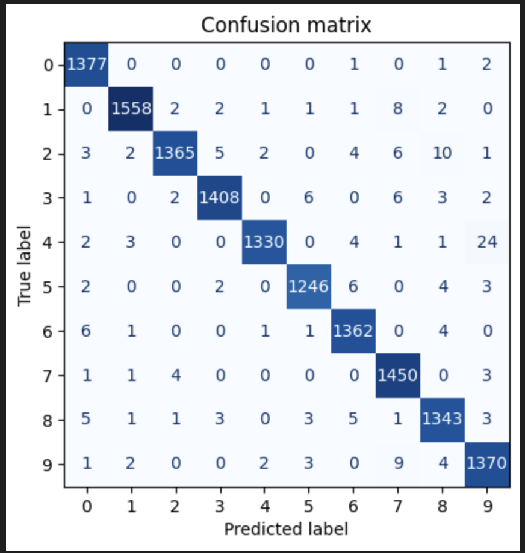
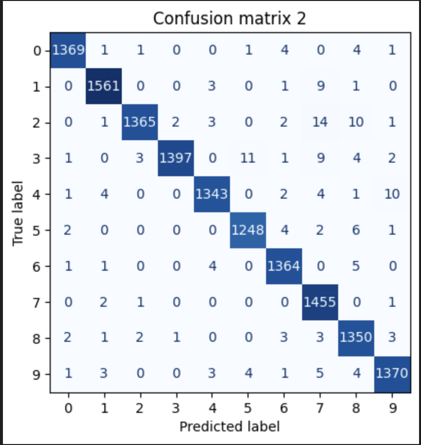

# Handwritten digit recognition on MNIST

A convolutional neural network trained to recognise handwritten digits along with the full analysis on where the CNN makes 
its mistakes and a singular change to see if those mistakes can be fixed. The first model reaches a test accuracy of 98.64%
while the second model a test accuracy of 98.73%, a difference too small to call genuine.

## Problem

The problem this project is called to solve is to read handwritten digits (in this specific case postcodes and account numbers)
and has to be judged on where it makes its mistakes.

## Data

The dataset used in this project is from MNIST: 70,000 greyscale images of handwritten digits each 28 by 28 pixels labelled from 0 to 9.
An 80/20 train/test split was used with a further 10% of the training set used for validation during training.

## The core

Model 1: Conv2D(32,3x3) -> MaxPooling(2x2) -> Dropout(0.3) -> Flatten -> Dense(64) -> Dense(10,softmax)
Model 2: Model 1 plus Conv2D(64,3x3) -> MaxPooling(2x2) before the Flatten layer.

Training: Adam used as the optimizer with sparse categorical cross-entropy, batch size 128, up to 15 epochs,
early stopping on validation loss (patience 3, best weights restored), random seed 42.

Evaluation: test accuracy and confusion matrices on the 14,000 unseen test images.

## Results

Model 1 scored a test accuracy of 98.64% on 347,146 parameters, ran 14 epochs with the best one being 11 with a val_loss of 0.0433.
Model 2 scored a test accuracy of 98.73% on 121,930 parameters, ran 9 epochs with the best one being 6 with a val_loss of 0.0433.

In terms of the first model the biggest confusions were 4->9 with 24 instances and 2->8 with 10.
In terms of the second model the biggest confusions were 2->7 with 14 instances and 3->5 with 11.

## Conclusions

The errors model 1 made are genuinely spread across with the two biggest one only accounting for 18% of them. Model 2 didn't really
put an end to that problem since the errors mainly moved around. Its improved accuracy is well into the run-to-run CNN limits so we
can't really come to a genuine conclusion on if the second model improved the situation. It is also advisable to note that model 2 had 
fewer parameters due to the extra pooling layer shrinking the flattened input.

## Reflection

What was achieved is a model which reached pretty high levels of accuracy quickly and we know exactly where it fails thanks to the
confusion matrices. In our situation it is advisable that the low-confidence predictions of the model are pushed for human review due to 
the high stakes in place. The most difficult thing regarding the project is to judge if the second model really improved things or not.
The main improvement I would make is to train each model with several seeds and compare the average and spread along with a confidence 
threshold that determines which predictions should move onto human review.